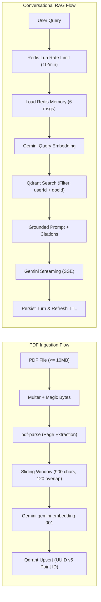

# AI Document Workspace

A production-grade, monorepo architecture for an **AI-powered Document Workspace** supporting intelligent document ingestion, vector semantic search, conversational RAG, and AI analysis.

> **Project Status:** Production-Ready Full-Stack Monorepo (Phases 1–11 Completed)  
> Features enterprise-grade PDF ingestion, page-aware text chunking, Google Gemini dense vector embeddings (768-dim), Qdrant vector search with multi-tenant filtering, conversational RAG with LangChain and Server-Sent Events (SSE) streaming, deterministic page citation badges, Redis sliding conversation memory (latest 6 messages, 1h TTL), atomic Redis Lua rate limiting (10 req/min), Base64URL cursor pagination, and an administrative intelligence dashboard with RBAC telemetry.

---

## 1. Project Overview & Architecture

### 1.1 Key Highlights
- **Full-Stack Monorepo**: Modern Next.js 14 App Router frontend paired with an Express.js TypeScript backend.
- **Strict Tenant Isolation**: User documents, vector points, Redis memory keys, and chat transcripts are strictly isolated by authenticated `userId`.
- **Conversational RAG**: Anti-hallucination grounded prompts with real-time SSE token streaming and clickable citations.
- **High-Performance Caching**: Redis sliding-window memory with rolling TTL and resilient MongoDB fallback.
- **Atomic Quota Enforcement**: Redis Lua script rate limiter safeguarding LLM resources.
- **Admin Intelligence Dashboard**: Real-time SaaS analytics, user activity tracking (`lastActiveAt` throttled writes), document pipeline health, and audit logs.
- **Automated Test Coverage**: 164 automated assertions across 8 comprehensive test suites passing at 100%.

### 1.2 System Architecture Diagram

```mermaid
flowchart TD
    subgraph Client ["Client Tier (Next.js 14 App Router)"]
        UserBrowser["User Browser"]
        AuthPages["Auth UI (/login, /register)"]
        UserDashboard["User Workspace (/dashboard)"]
        ChatUI["Streaming Chat UI (/dashboard/documents/:id/chat)"]
        AdminDashboard["Admin Dashboard (/dashboard/admin)"]
    end

    subgraph BackendAPI ["Express.js Backend API (Node.js & TypeScript)"]
        Gateway["Express Server & Middleware (Helmet, CORS, CookieParser)"]
        AuthModule["Auth & RBAC Module (JWT Cookies, 5m Activity Throttle)"]
        DocModule["Document Module (Multer, Magic Bytes Check, Page Chunker)"]
        ChatModule["Chat & RAG Module (SSE Streamer, Citation Builder)"]
        AdminModule["Admin Module (Metrics Aggregation & Activity Log)"]
    end

    subgraph Storage ["Persistence & In-Memory Tier"]
        MongoDB[("MongoDB Atlas Cloud (Users, Docs, Chunks, Messages)")]
        RedisCache[("Redis 7 Docker (Sliding Memory, Lua Rate Limiter)")]
        QdrantDB[("Qdrant Vector DB Docker (768-dim Cosine Vectors)")]
    end

    subgraph AIServices ["Google Gemini AI Tier"]
        GeminiEmbed["gemini-embedding-001 (768-dim TaskType.RETRIEVAL_DOCUMENT)"]
        GeminiChat["gemini-flash-lite-latest (Conversational LLM via LangChain)"]
    end

    UserBrowser --> AuthPages & UserDashboard & ChatUI & AdminDashboard
    AuthPages & UserDashboard & ChatUI & AdminDashboard --> Gateway

    Gateway --> AuthModule & DocModule & ChatModule & AdminModule

    AuthModule -->|User Profiles & lastActiveAt| MongoDB
    DocModule -->|Metadata & DocumentChunks| MongoDB
    DocModule -->|Generate Embeddings| GeminiEmbed
    DocModule -->|Upsert Chunks with Tenant Payload| QdrantDB

    ChatModule -->|Sliding Context (Last 6 Msgs)| RedisCache
    ChatModule -->|Multi-Tenant Semantic Retrieval| QdrantDB
    ChatModule -->|Stream Tokens & Context| GeminiChat
    ChatModule -->|Persist Completed Turns| MongoDB

    AdminModule -->|Aggregate SaaS Metrics| MongoDB
```

### 1.3 Ingestion & RAG Data Flow



---

## 2. Technology Stack

### Frontend
- **Framework:** Next.js 14 (App Router)
- **Language:** TypeScript
- **State Management:** React Context (`AuthContext` with HTTP-only cookie session)
- **Styling:** Tailwind CSS
- **Icons:** Lucide React
- **Package Manager:** npm

### Backend
- **Runtime:** Node.js (v20+ LTS)
- **Framework:** Express.js
- **Language:** TypeScript
- **Validation:** Zod
- **Database:** MongoDB Atlas (Mongoose v8)
- **Authentication:** JSON Web Tokens (`jsonwebtoken`), `bcryptjs`, `cookie-parser`
- **Cache / Message Queue:** Redis (node-redis v4)
- **Vector Engine:** Qdrant (@qdrant/js-client-rest)
- **Security:** Helmet, CORS with credentials, and HTTP-only cookies

### Infrastructure
- **Cache / Queue:** Redis 7 (Docker, `redis:7-alpine`, AOF enabled)
- **Vector DB:** Qdrant (Docker, `qdrant/qdrant:v1.13.2`)
- **Primary Database:** MongoDB Atlas (External cloud-hosted cluster)
- **Orchestration:** Docker Compose
- **AI Provider:** Google Gemini API (Phase 4 integration)

---

## 3. Folder Structure

```
ai-document-workspace/
├── frontend/
│   ├── public/
│   │   └── favicon.svg
│   ├── src/
│   │   ├── app/
│   │   │   ├── dashboard/
│   │   │   │   ├── admin/
│   │   │   │   │   └── page.tsx        # Protected Admin Dashboard (RBAC telemetry & live audit feed)
│   │   │   │   ├── documents/[id]/chat/
│   │   │   │   │   └── page.tsx        # Real-time SSE streaming chat with citations & markdown
│   │   │   │   └── page.tsx            # Protected user workspace, quick upload & document library
│   │   │   ├── login/
│   │   │   │   └── page.tsx            # Sign-in form
│   │   │   ├── register/
│   │   │   │   └── page.tsx            # Registration form
│   │   │   ├── globals.css
│   │   │   ├── layout.tsx              # Root layout wrapped in AuthProvider
│   │   │   └── page.tsx
│   │   ├── components/
│   │   │   ├── DocumentLibrary.tsx     # Document table, pagination, delete & chat navigation
│   │   │   ├── DocumentUploadZone.tsx  # Drag-and-drop PDF upload with progress
│   │   │   ├── InfrastructureStatus.tsx
│   │   │   ├── Navbar.tsx              # Session-aware navigation & user pill
│   │   │   └── ProtectedRoute.tsx      # Client-side route protection
│   │   ├── context/
│   │   │   └── AuthContext.tsx         # Centralized auth state & session hooks
│   │   ├── hooks/
│   │   │   └── useBackendHealth.ts
│   │   ├── lib/
│   │   │   ├── api.ts                  # Centralized API endpoints (including CHAT)
│   │   │   └── utils.ts
│   │   ├── services/
│   │   │   ├── api.service.ts          # Authentication & document client fetchers
│   │   │   └── chat.service.ts         # SSE streaming chat client & history fetcher
│   │   └── types/
│   │       └── api.ts
│   ├── .dockerignore
│   ├── .env.example
│   ├── Dockerfile
│   ├── next.config.mjs
│   ├── package.json
│   ├── postcss.config.mjs
│   ├── tailwind.config.ts
│   └── tsconfig.json
│
├── backend/
│   ├── src/
│   │   ├── config/
│   │   │   ├── connectServices.ts  # Centralized dependency initialization & status
│   │   │   ├── database.ts         # MongoDB Atlas client (Mongoose)
│   │   │   ├── env.ts              # Zod environment schema & validation (with UPLOAD_DIR)
│   │   │   ├── qdrant.ts           # Qdrant vector client & ping check
│   │   │   └── redis.ts            # node-redis client with reconnection logic
│   │   ├── middleware/
│   │   │   ├── auth.ts             # authenticate & authorize (RBAC) middleware
│   │   │   ├── errorHandler.ts
│   │   │   └── notFoundHandler.ts
│   │   ├── modules/
│   │   │   ├── admin/
│   │   │   │   ├── admin.controller.ts # Platform metrics aggregation & activity feed
│   │   │   │   └── admin.router.ts     # Protected /api/admin routes (RBAC: admin role only)
│   │   │   ├── auth/
│   │   │   │   ├── auth.controller.ts # register, login, getCurrentUser, logout, adminTest
│   │   │   │   ├── auth.router.ts     # /api/auth routes
│   │   │   │   ├── auth.utils.ts      # JWT sign/verify, HTTP-only cookie handlers
│   │   │   │   ├── auth.validation.ts # Zod registration & login schemas
│   │   │   │   └── user.model.ts       # Mongoose user schema & password hashing
│   │   │   ├── chat/
│   │   │   │   ├── chat.controller.ts  # SSE streaming chat handler & history retrieval
│   │   │   │   ├── chat.model.ts       # Mongoose ChatMessage model & citation schema
│   │   │   │   ├── chat.router.ts      # /api/chat routes with auth
│   │   │   │   └── chat.service.ts     # LangChain RAG pipeline, streaming & citations
│   │   │   ├── documents/
│   │   │   │   ├── document.controller.ts  # upload, list, getById, delete, reindex, search
│   │   │   │   ├── document.model.ts       # Mongoose Document model, indexing status & user index
│   │   │   │   ├── document.router.ts      # /api/documents routes with auth & search endpoints
│   │   │   │   ├── document.upload.ts      # Multer storage, size limits & magic byte check
│   │   │   │   └── documentChunk.model.ts  # Mongoose DocumentChunk model & compound indexes
│   │   │   └── health/
│   │   │       ├── health.controller.ts # Liveness & Readiness handlers
│   │   │       └── health.router.ts
│   │   ├── scripts/
│   │   │   ├── seedAdmin.ts            # Secure CLI admin account seeding
│   │   │   ├── testPhase3Auth.ts       # 9-point automated auth & RBAC test suite
│   │   │   ├── testPhase4Documents.ts  # 11-point automated document & upload test suite
│   │   │   ├── testPhase5Processing.ts # 29-point automated PDF extraction, chunking & embedding test suite
│   │   │   ├── testPhase6Qdrant.ts     # 37-point automated vector indexing & semantic retrieval test suite
│   │   │   ├── testPhase7Chat.ts       # 18-point automated conversational RAG & chat test suite
│   │   │   ├── testPhase9Pagination.ts # 20-point automated cursor pagination test suite
│   │   │   ├── testPhase10Admin.ts     # 20-point automated Admin Dashboard & RBAC test suite
│   │   │   └── verifyManualLiveGemini.ts # Live Gemini manual end-to-end verification script
│   │   ├── services/
│   │   │   ├── documentProcessor.ts    # Background processing pipeline & vector indexing trigger
│   │   │   ├── embeddingService.ts     # Gemini embedding client (TaskType document & query with retry)
│   │   │   ├── pdfExtractor.ts         # Page-by-page PDF text extraction via pdf-parse
│   │   │   ├── textChunker.ts          # Sliding window chunking with configurable overlap
│   │   │   └── vectorStore.ts          # Qdrant collection init, batch upsert, deterministic IDs, search & delete
│   │   ├── utils/
│   │   │   ├── logger.ts
│   │   │   └── response.ts
│   │   ├── app.ts
│   │   ├── server.ts               # Server startup & graceful shutdown
│   │   └── verify-phase2.ts
│   ├── uploads/                    # Local storage for development uploads
│   ├── .dockerignore
│   ├── .env.example
│   ├── Dockerfile
│   ├── package.json
│   └── tsconfig.json
│
├── docker-compose.yml
├── .gitignore
└── README.md
```

---

## 4. Authentication & RBAC APIs

| Method | Endpoint | Access | Description |
| :--- | :--- | :--- | :--- |
| `POST` | `/api/auth/register` | Public | Register user (assigned `user` role; sets HTTP-only cookie) |
| `POST` | `/api/auth/login` | Public | Authenticate user via email/password; sets HTTP-only cookie |
| `POST` | `/api/auth/logout` | Public | Clear HTTP-only authentication cookie |
| `GET` | `/api/auth/me` | Authenticated | Retrieve authenticated user's safe profile |
| `GET` | `/api/auth/admin-test` | Admin Only | Restricted test route enforcing RBAC (`role: 'admin'`) |

---

## 5. Document Management APIs (Phase 4)

| Method | Endpoint | Access | Description |
| :--- | :--- | :--- | :--- |
| `POST` | `/api/documents/upload` | Authenticated | Upload PDF file (multipart/form-data, max 10MB, magic byte check) |
| `GET` | `/api/documents` | Authenticated | List documents belonging to authenticated user (paginated: `page`, `limit`) |
| `GET` | `/api/documents/:id` | Authenticated | Get document metadata (strict ownership enforcement: returns 404 for others) |
| `DELETE` | `/api/documents/:id` | Authenticated | Delete document record, physical file, MongoDB chunks, and Qdrant vectors |
| `POST` | `/api/documents/:id/reindex` | Authenticated | Manually trigger vector re-indexing for a ready document |
| `POST` | `/api/documents/:id/search` | Authenticated | Semantic vector search within document with cosine similarity scoring & fallback |

### Upload Security & Storage
- **File Type & Size Restrictions**: Only PDF files (`.pdf` and `application/pdf`) up to **10 MB** are accepted.
- **Magic Bytes Validation**: Reads the first 4 bytes of uploaded files to confirm `%PDF` (`0x25 0x50 0x44 0x46`). Spoofed extensions (e.g., text/executables renamed to `.pdf`) are rejected with `400 Bad Request` and immediately deleted.
- **Unique Safe Filenames**: Files are saved with `<timestamp>-<uuid4>.pdf` to prevent directory traversal and file overwriting.
- **Orphan Cleanup**: Temporary/failed uploads and deleted documents are automatically removed from the local `uploads/` directory.

---

## 6. PDF Processing, Chunking & Gemini Embedding Pipeline (Phase 5)

### 6.1 PDF Text Extraction (`pdfExtractor.ts`)
- Utilizes the modern `pdf-parse` v2 `PDFParse` class to parse uploaded PDF binaries page by page.
- Extracts per-page text objects: `{ pageNumber: number, text: string }`.
- Preserves accurate page numbering across multi-page documents.
- Inspects cumulative character length: documents with empty text streams (e.g., scanned images without OCR) receive a descriptive error (`"This PDF contains no extractable text layer. Scanned PDFs without OCR cannot be processed."`).
- Catches password-protected and corrupted/malformed PDFs and translates them into user-friendly error messages while logging technical details.
- Always releases internal PDF.js worker and memory resources in `finally { await parser.destroy(); }`.

### 6.2 Text Chunking Strategy (`textChunker.ts`)
- **Algorithm**: Character-based sliding window with overlap applied independently within each page.
- **Configurable Settings**:
  - `CHUNK_SIZE`: Default **900 characters** (configurable via environment variable `CHUNK_SIZE`, minimum 100).
  - `CHUNK_OVERLAP`: Default **120 characters** (configurable via environment variable `CHUNK_OVERLAP`, non-negative).
  - `step`: Calculated as `CHUNK_SIZE - CHUNK_OVERLAP` (780 characters).
- **Boundary Guarantee**: Consecutive chunks within a page share exactly 120 characters of contextual overlap, preventing loss of sentences and semantics across chunk cuts.
- **Page Isolation**: `chunkIndex` is scoped to each page (starting from `0`), and `pageNumber` is explicitly preserved.
- **Short Pages & Edge Cases**: Pages shorter than `CHUNK_SIZE` generate a single concise chunk. Empty/whitespace-only pages generate 0 chunks.

### 6.3 DocumentChunk Schema & Database Persistence (`documentChunk.model.ts`)
```typescript
{
  documentId: ObjectId,  // Reference to Document
  userId: ObjectId,      // Reference to User (ownership scope)
  pageNumber: Number,    // 1-indexed PDF page number
  chunkIndex: Number,    // 0-indexed chunk offset on this page
  text: String,          // Extracted chunk text segment
  charCount: Number,     // Exact character length of chunk text
  timestamps: true       // createdAt, updatedAt
}
```
- **Compound Indexes**:
  - `{ documentId: 1, pageNumber: 1, chunkIndex: 1 }` with `{ unique: true }` prevents duplicate chunk creation during reprocessing.
  - `{ userId: 1, documentId: 1 }` guarantees high-speed ownership filtering.
  - `{ documentId: 1 }` enables rapid retrieval and cascade deletion.
- **Vector Storage Note**: Vectors are **not** persisted in MongoDB. In accordance with architectural boundaries, embeddings are generated for indexing in Qdrant (Phase 6).

### 6.4 Google Gemini Embedding Service (`embeddingService.ts`)
- **Official SDK**: Built using `@google/generative-ai` with `TaskType.RETRIEVAL_DOCUMENT`.
- **Model**: `gemini-embedding-001` with `outputDimensionality: 768`, producing standard 768-dimensional dense vectors matching the project `EMBEDDING_DIMENSION` configuration.
- **Resilience**: Implements bounded retry logic (up to 3 attempts) with exponential backoff (`500ms`, `1000ms`, `2000ms`) for transient rate-limit (HTTP 429) or temporary server errors (HTTP 503).
- **Security**: The Gemini API key remains strictly on the backend and is never sent to the client or embedded in public bundles.

### 6.5 Processing Pipeline & Lifecycle Management (`documentProcessor.ts`)
- **Workflow**:
  1. File uploaded -> Saved in MongoDB with `status: 'uploaded'`.
  2. Background execution triggered asynchronously via `setImmediate` without blocking client response.
  3. Status set to `processing`.
  4. Text extracted page by page via `extractPdfText`.
  5. Chunks generated via `chunkPages`.
  6. Existing chunks for this document cleared and new chunks inserted in MongoDB.
  7. Document status updated to `ready` with `totalPages` and `totalChunks` recorded.
  8. If any step fails, document status is marked `failed` with a user-friendly `processingError`.
- **Crash Recovery**: `resetStuckDocuments()` runs automatically at server startup to reset any documents left in `processing` status by an unexpected crash/restart to `failed`.
- **Cascade Deletion**: When a user deletes a document via `DELETE /api/documents/:id`, `deleteDocumentChunks(documentId)` automatically deletes all corresponding `DocumentChunk` records from MongoDB.
- **Known Limitations**: OCR is not implemented in this phase. Scanned PDFs with image-only text layers are rejected with a clear user notice.

---

## 7. Qdrant Vector Indexing & Semantic Retrieval (Phase 6)

### 7.1 Collection Initialization & Payload Indexes (`vectorStore.ts`)
- **Collection**: `document_chunks`
- **Vector Dimension**: `768` (matching Google Gemini `gemini-embedding-001`)
- **Distance Metric**: `Cosine`
- Automatically initialized on backend boot via `initQdrantCollection()` in `connectServices.ts`.
- Payload keyword indexes are created with `{ wait: true }` to support high-throughput filtered vector search:
  - `userId` (keyword)
  - `documentId` (keyword)
  - `chunkId` (keyword)

### 7.2 Point ID & Payload Architecture
- **Deterministic Point ID Generation**: Point IDs are UUID v5 generated using a dedicated workspace namespace UUID (`a1b2c3d4-e5f6-7890-abcd-ef1234567890`) and the chunk's MongoDB `_id` (`chunkIdToPointId(chunkId)`).
  - Guarantees idempotent upserts: re-indexing updates points in-place without duplicating records or causing index bloat.
- **Stored Payload Fields**:
  - `chunkId`: MongoDB string ID of the chunk
  - `documentId`: MongoDB string ID of the document
  - `userId`: Owner user string ID
  - `pageNumber`: PDF page number (1-indexed)
  - `chunkIndex`: Chunk offset on page (0-indexed)
  - `text`: Extracted chunk text segment

### 7.3 Google Gemini Dual-Task Embedding (`embeddingService.ts`)
- `TaskType.RETRIEVAL_DOCUMENT`: Used for chunk embeddings when indexing documents (`embedDocument`).
- `TaskType.RETRIEVAL_QUERY`: Used for search query embeddings when performing semantic search (`embedQuery`).
- Both paths enforce `outputDimensionality: 768` and retry resilience (up to 3 attempts with exponential backoff).

### 7.4 Indexing Lifecycle & Concurrency Controls
- **Document Model Indexing Fields**:
  - `indexingStatus`: `'pending' | 'indexing' | 'indexed' | 'failed'`
  - `indexedChunkCount`: Number of vectors successfully indexed in Qdrant
  - `indexingError`: User-safe error description on indexing failure
  - `indexedAt`: Timestamp of indexing completion
- **Automatic Background Trigger**: When `documentProcessor.ts` transitions a document to `ready`, it automatically triggers `indexDocumentChunks(doc._id, doc.userId)`.
- **Concurrency Lock**: An in-memory `activeIndexingJobs` Set prevents duplicate concurrent indexing jobs on the same document.
- **Bounded Batch Upserts**: Chunks are embedded and upserted in bounded batches of 20 points, minimizing memory overhead and avoiding payload timeouts.
- **Crash Recovery**: `resetStuckIndexingDocuments()` runs on server startup, converting any documents stranded in `'indexing'` status into `'failed'`.

### 7.5 Semantic Retrieval & Strict Tenant Isolation
- **Endpoint**: `POST /api/documents/:id/search`
- **Request Body**: `{ query: string, limit?: number }` (default limit: 5, max: 50)
- **Response Format**:
  ```json
  {
    "status": "success",
    "data": {
      "documentId": "6afeb3ede33fbe403673b2e5",
      "query": "LangChain LangGraph multi-agent architecture and Redis",
      "results": [
        {
          "chunkId": "6afeb3f0e33fbe403673b2f2",
          "pageNumber": 1,
          "chunkIndex": 2,
          "text": "...",
          "score": 0.7083
        }
      ]
    }
  }
  ```
- **Strict Multi-Tenant Filtering**: Mandatory Qdrant payload filters:
  ```typescript
  must: [
    { key: "userId", match: { value: userId } },
    { key: "documentId", match: { value: documentId } }
  ]
  ```
  Points belonging to other users or other documents are excluded by Qdrant's query engine before scoring.
- **MongoDB Fallback**: If vector search fails or returns zero matches, a text fallback query executes against MongoDB chunks.

### 7.6 Re-indexing & Cascade Deletion
- **Re-indexing Endpoint**: `POST /api/documents/:id/reindex` allows users to manually re-index documents if indexing failed or needs refreshing.
- **Cascade Vector Deletion**: When a user deletes a document via `DELETE /api/documents/:id`, `deletePointsByDocumentId(documentId)` automatically deletes all corresponding Qdrant points using the `documentId` payload index filter.

---

## 8. Conversational RAG & AI Chat with SSE Streaming (Phase 7)

### 8.1 Conversational RAG Architecture & Flow (`chat.service.ts`)
```
User Question ──► authenticate ──► Verify Ownership & Ready/Indexed
                      │
                      ▼
              searchSimilarChunks (Qdrant)
              [Filters: userId + documentId]
                      │
                      ▼
              Grounded System Prompt
              + Bounded Chat History (Last 6 Messages)
                      │
                      ▼
       LangChain ChatGoogleGenerativeAI
       (gemini-flash-lite-latest, temp: 0.2)
                      │
            ┌─────────┴─────────┐
            ▼                   ▼
    Stream Tokens (SSE)   Derive Citations
    event: token          event: citations
            │                   │
            └─────────┬─────────┘
                      ▼
          Persist in MongoDB (ChatMessage)
          event: done { messageId, content, citations }
```

### 8.2 Grounded Anti-Hallucination Prompt Design
- **Strict Grounding**: The AI model is strictly instructed to answer based solely on the provided document excerpts.
- **Missing Information Guarantee**: If the document excerpts do not contain the answer to the user's question, the assistant explicitly responds: *"The uploaded document does not contain sufficient information to answer this question."*
- **No Hallucinated Citations**: The model is prohibited from inventing page numbers or chunk IDs. Source citations are computed deterministically by the backend.

### 8.3 Server-Sent Events (SSE) Protocol & Endpoints

| Method | Endpoint | Access | Description |
| :--- | :--- | :--- | :--- |
| `POST` | `/api/chat/:documentId/messages` | Authenticated | Send user question and stream RAG answer via Server-Sent Events (SSE) |
| `GET` | `/api/chat/:documentId/messages` | Authenticated | Retrieve chronological chat history for document |

#### SSE Event Format:
```http
event: start
data: {"status":"started"}

event: citations
data: {"citations":[{"chunkId":"6afec7638ff8...","pageNumber":1,"chunkIndex":1,"text":"Puppeteer-based PDF export pipeline..."}]}

event: token
data: {"token":"Based on "}

event: token
data: {"token":"the resume, the main skills are..."}

event: done
data: {"messageId":"6afecf56...","content":"...","citations":[...],"createdAt":"2026-11-19T10:28:38.726Z"}
```

### 8.4 Deterministic Citation Generation (`buildCitations`)
- Citations are derived exclusively from actual retrieved Qdrant chunk points (`chunkId`, `pageNumber`, `chunkIndex`, `text`).
- Deduplicates page numbers so users receive clear, distinct source citations (e.g. `Source: Page 1`).
- The frontend provides clickable citation badges that expand to reveal the exact supporting text excerpt from the document.

### 8.5 ChatMessage Schema & Indexing (`chat.model.ts`)
```typescript
{
  userId: ObjectId,       // Reference to User (indexed)
  documentId: ObjectId,   // Reference to Document (indexed)
  role: 'user' | 'assistant',
  content: String,
  citations: [
    {
      chunkId: String,
      pageNumber: Number,
      chunkIndex: Number,
      text: String
    }
  ],
  timestamps: true        // createdAt, updatedAt
}
```
- **Compound Indexes**:
  - `{ documentId: 1, userId: 1, createdAt: 1 }`: Optimized for chronological chat history rendering.
  - `{ userId: 1, createdAt: -1 }`: Rapid user-specific query lookup.

### 8.6 Client Disconnection & Lifecycle Safeguards
- When a client disconnects or clicks the "Stop" button in the frontend, `req.on('close')` fires an `AbortSignal`.
- The generation loop terminates cleanly without server crashes.
- Failed or aborted generations do **not** persist incomplete or misleading assistant messages to MongoDB.

### 8.7 Environment Variables (Phase 7)
- `GEMINI_API_KEY`: Google Gemini API key (strictly backend-only; never exposed to browser bundles).
- `GEMINI_CHAT_MODEL`: Google Gemini chat model (default: `gemini-flash-lite-latest`).

### 8.8 Known Limitations & Scope Boundaries
- **No Redis Conversation Memory in Phase 7**: MongoDB Atlas is the single source of truth for chat history in this phase. Context is bounded to recent MongoDB messages.
- **No Redis Rate Limiting**: Chat rate limiting and conversation caching belong strictly to Phase 8.

---

## 9. Redis Memory, Chat Rate Limiting & Cursor Pagination (Phase 8 & Phase 9)

### 9.1 Redis Sliding Window Conversation Memory
- **Memory Key Scheme**: `chat:memory:{userId}:{documentId}`.
- **Sliding Window**: Strictly bounds chat context to the latest 6 messages (`user` and `assistant` pairs).
- **TTL Strategy**: 1-hour (3600s) rolling TTL refreshed automatically on every successful chat turn.
- **MongoDB Fallback**: Cache misses or key expirations seamlessly query authoritative MongoDB records and repopulate Redis memory.
- **Resilience**: Malformed or corrupted Redis payloads are caught safely with immediate MongoDB fallback without crashing the process.

### 9.2 Atomic Chat Rate Limiting (Redis Lua)
- **Quota**: Strictly enforced limit of 10 chat requests per 60 seconds per user.
- **Atomic Lua Script**: Evaluates and increments sliding counter atomically in Redis.
- **Headers & Status**: HTTP 429 Too Many Requests with `Retry-After` header when limit exceeded.
- **Fail-Closed Security**: Redis downtime triggers safe HTTP 503 Service Unavailable to protect LLM infrastructure from unmetered surges.
- **Exclusions**: Read-only history pagination (`GET /api/chat/:documentId/messages`) is excluded from rate limiting.

### 9.3 Cursor-Based Pagination
- **Format**: URL-safe Base64URL encoding of composite payload `{ createdAt, id }`.
- **Compound Sorting**: Sorted by `createdAt: -1, _id: -1` for stable pagination without duplicates or skipped records across deep pagination.
- **Compound Database Indexes**:
  - `DocumentModel`: `{ userId: 1, createdAt: -1, _id: -1 }`
  - `ChatMessage`: `{ userId: 1, documentId: 1, createdAt: -1, _id: -1 }`
- **Frontend Integration**: Infinite "Load older messages" prepend in chat and "Load more documents" append in library.

---

## 10. Admin Dashboard & Role-Based Access Control (Phase 10)

### 10.1 Architecture & Role Segregation
- **Strict Role-Based Access Control**:
  - Endpoints (`/api/admin/stats` and `/api/admin/activity`) are gated by `authenticate` and `authorize('admin')` middleware.
  - Unauthenticated requests receive `HTTP 401 Unauthorized`.
  - Regular users (`role === 'user'`) receive `HTTP 403 Forbidden` (`{ status: 'error', message: 'Forbidden: Admin access required.' }`).
  - Client-side RBAC protection at `/dashboard/admin`: renders a 403 Access Denied screen for regular users with a redirect button back to the workspace.
  - Dynamic `Navbar`: The "Admin Dashboard" navigation link is rendered only when `user.role === 'admin'`.

### 10.2 User Activity Tracking (`lastActiveAt`)
- **Field & Indexing**: `lastActiveAt?: Date` indexed in `UserModel` (`{ lastActiveAt: 1 }`).
- **Throttled Background Updates**: `authenticate` middleware throttles database writes to a maximum of once every 5 minutes per user using an in-memory cache, eliminating unnecessary write load on high-frequency API calls.
- **Login Tracking**: Updated immediately whenever a user authenticates via `POST /api/auth/login`.
- **Active Users Metric**: Defined strictly as `lastActiveAt >= new Date(Date.now() - 30 * 24 * 60 * 60 * 1000)` (active within the last 30 days).

### 10.3 Admin Endpoints & SaaS Metrics Aggregation
| Method | Endpoint | RBAC Guard | Description |
| :--- | :--- | :--- | :--- |
| `GET` | `/api/admin/stats` | `admin` only | Comprehensive SaaS platform statistics across users, documents, and chat |
| `GET` | `/api/admin/activity` | `admin` only | Real-time platform audit feed merging user, document, and chat activity |

#### Statistics Payload Breakdown (`/api/admin/stats`):
- **Users**: `total`, `active` (last 30d), `new7d` (registered in last 7 days), `new30d` (registered in last 30 days).
- **Documents**: `total`, `processing`, `ready`, `failed`, `indexed`, `indexingFailed`.
- **Chat**: `totalMessages`, `totalConversations` (distinct `(userId, documentId)` conversation pairs via MongoDB `$group` aggregation).

#### Activity Feed Payload Breakdown (`/api/admin/activity`):
- Aggregates real events from MongoDB: user registrations, document uploads/indexing status, and chat messages.
- Supports category filtering via `?category=user|document|chat`.
- Clamped pagination via `?limit=N` (default 20, max 50).
- **Zero Sensitive Data**: Sensitive fields (`password`, password hashes, tokens) are completely stripped and excluded from all responses.

---

## 11. Seed Initial Admin Account

To safely initialize an administrator without exposing an open admin registration endpoint:

```bash
cd backend
npx tsx src/scripts/seedAdmin.ts --email=admin@workspace.internal --password=AdminSecure123! --name="Platform Administrator"
```
Or define in `backend/.env`:
```env
ADMIN_EMAIL=admin@workspace.internal
ADMIN_PASSWORD=AdminSecure123!
ADMIN_NAME=Platform Administrator
```
and execute:
```bash
npm run seed:admin
```

---

## 12. Testing & Verification Commands

### Run Full Phase 10 Admin Dashboard & RBAC Test Suite (20 Tests)
```bash
cd backend
npm run test:phase10
```
All 20 tests verify:
1. Admin user receives HTTP 200 on `GET /api/admin/stats` with complete payload.
2. Unauthenticated request to `/api/admin/stats` rejected with HTTP 401.
3. Regular user receives HTTP 403 Forbidden on `/api/admin/stats`.
4. Admin user receives HTTP 200 on `GET /api/admin/activity`.
5. Unauthenticated request to `/api/admin/activity` rejected with HTTP 401.
6. Regular user receives HTTP 403 Forbidden on `/api/admin/activity`.
7. Total registered users count accurately calculated.
8. Active users count strictly enforces 30-day activity window (`lastActiveAt >= now - 30d`).
9. Inactive users (>30 days) are correctly excluded from active users count.
10. New users in last 7 days and 30 days calculated accurately.
11. Document processing status metrics (total, processing, ready, failed) match DB.
12. Vector indexing metrics (indexed, failed) match DB.
13. Total chat messages count matches DB.
14. Unique conversation pairs `(userId, documentId)` accurately counted via aggregation.
15. Recent activity feed contains real events (registrations, documents, chats).
16. Zero sensitive data (passwords, password hashes) exposed in admin responses.
17. Public registration ignores `role` payload and safely assigns default `user` role.
18. Admin user seeding idempotently creates or updates admin without duplicate records.
19. Authenticated request triggers throttled update of user's `lastActiveAt` field.
20. Regular user dashboard and document library routes remain fully operational.

### Run Full Phase 9 Cursor-Based Pagination Test Suite (20 Tests)
```bash
cd backend
npm run test:phase9
```
All 20 tests verify:
1. `encodeCursor` produces a URL-safe Base64URL string containing `createdAt` and `id`.
2. `decodeCursor` accurately reconstructs original `Date` and `ObjectId`.
3. `decodeCursor` returns null for corrupted/malformed Base64 string.
4. `decodeCursor` returns null for invalid date string in cursor.
5. `decodeCursor` returns null for invalid ObjectId in cursor.
6. `GET /api/documents` returns first page with default limit 10 and valid `nextCursor`.
7. `GET /api/documents` rejects invalid/tampered cursor with HTTP 400 Bad Request.
8. `GET /api/documents` with cursor fetches the next page without skipping or duplicating items.
9. Compound comparison correctly handles documents with identical `createdAt` timestamps via `_id` tie-breaker.
10. Cursor pagination enforces limit upper bound (clamps to max 50).
11. Last page of documents returns `hasMore: false` and `nextCursor: null`.
12. Document cursor pagination strictly isolates user data (User A never sees User B's documents).
13. `GET /api/chat/:documentId/messages` returns first page with default limit 20 and valid `nextCursor`.
14. `GET /api/chat/:documentId/messages` rejects invalid/tampered cursor with HTTP 400 Bad Request.
15. `GET /api/chat/:documentId/messages` with cursor retrieves older messages with stable ordering.
16. Messages with identical timestamps paginate predictably without duplicates.
17. Last page of chat history returns `hasMore: false` and `nextCursor: null`.
18. Chat history pagination strictly enforces multi-tenant document ownership.
19. Document model index `{ userId: 1, createdAt: -1, _id: -1 }` is verified in Mongoose schema.
20. ChatMessage model index `{ userId: 1, documentId: 1, createdAt: -1, _id: -1 }` is verified in Mongoose schema.

### Run Full Phase 8 Redis Conversation Memory & Rate Limiting Test Suite (20 Tests)
```bash
cd backend
npm run test:phase8
```
All 20 tests verify:
1. Redis connection and ping verification.
2. Memory key format strictly follows `chat:memory:{userId}:{documentId}`.
3. Memory capacity strictly bounded to the latest 6 messages.
4. Preservation of message roles (`user`, `assistant`) and chronological sequence.
5. 1-hour (3600s) TTL applied to active memory keys.
6. Rolling TTL refresh back to 3600s on each successful turn.
7. Seamless fallback to MongoDB on cache miss with automatic Redis repopulation.
8. Recovery from expired keys through authoritative MongoDB records.
9. Resilient handling of malformed/corrupted Redis cache data without server crashes.
10. Fallback to MongoDB during simulated Redis outages.
11. Failed AI generation does NOT write incomplete assistant messages to memory.
12. Aborted generation / client disconnect does NOT store partial stream text.
13. User A cannot read or pollute User B's conversation memory.
14. Conversation memory for Document A does not bleed into Document B.
15. First 10 chat requests within a 60-second window are accepted (HTTP 200).
16. 11th chat request is rejected with HTTP 429 Too Many Requests.
17. `Retry-After` header is present and populated with remaining window seconds.
18. Different users have completely independent rate limit quotas.
19. Rate-limit counters are atomic under concurrent requests via Redis Lua script.
20. `GET /api/chat/:documentId/messages` is excluded from the chat rate limiter.

### Run Full Phase 7 Conversational RAG & Chat Test Suite (18 Tests)
```bash
cd backend
npm run test:phase7
```

### Run Full Phase 6 Qdrant Vector Indexing & Retrieval Test Suite (37 Tests)
```bash
cd backend
npm run test:phase6
```

### Run Full Phase 5 Processing, Chunking & Embedding Test Suite (29 Tests)
```bash
cd backend
npm run test:phase5
```

### Run Document Management & Upload Test Suite (11 Tests)
```bash
cd backend
npm run test:docs
```

### Run Full Authentication & RBAC Test Suite (9 Tests)
```bash
cd backend
npm run test:auth
```

### Run Typechecks & Builds
```bash
# Backend
cd backend
npm run typecheck
npm run build

# Frontend
cd frontend
npm run typecheck
npm run build
```

---

## 13. Prerequisites & Local Environment Setup

### 13.1 Prerequisites
- **Node.js**: v20.x or v22.x LTS
- **Package Manager**: npm v10+
- **Docker & Docker Compose**: Docker Engine v24+ with Compose v2
- **MongoDB Atlas**: An active MongoDB Atlas database cluster connection string (or local MongoDB v7+)
- **Google Gemini API**: A valid API key with access to `gemini-flash-lite-latest` and `gemini-embedding-001`

### 13.2 Environment Configuration

1. **Backend Environment**:
   Copy `backend/.env.example` to `backend/.env`:
   ```bash
   cp backend/.env.example backend/.env
   ```
   Configure the following variables in `backend/.env`:
   ```env
   PORT=5000
   NODE_ENV=development
   FRONTEND_URL=http://localhost:3000
   
   # Cloud Database
   MONGODB_URI=mongodb+srv://<username>:<password>@cluster.mongodb.net/ai_workspace?retryWrites=true&w=majority
   
   # Local Infrastructure (Docker Compose)
   REDIS_URL=redis://localhost:6379
   QDRANT_URL=http://localhost:6333
   
   # AI Configuration (Backend-Only)
   GEMINI_API_KEY=your_actual_gemini_api_key_here
   GEMINI_CHAT_MODEL=gemini-flash-lite-latest
   GEMINI_EMBEDDING_MODEL=gemini-embedding-001
   EMBEDDING_DIMENSION=768
   
   # Security & Session
   JWT_SECRET=your_secure_jwt_secret_minimum_32_characters_long
   JWT_EXPIRES_IN=1d
   
   # Uploads
   UPLOAD_DIR=uploads
   ```

2. **Frontend Environment**:
   Copy `frontend/.env.example` to `frontend/.env.local`:
   ```bash
   cp frontend/.env.example frontend/.env.local
   ```
   Configure:
   ```env
   NEXT_PUBLIC_API_URL=http://localhost:5000/api
   ```

---

## 14. Quickstart Guide (Step-by-Step)

### Step 1: Install Dependencies
```bash
# Install backend dependencies
cd backend
npm install

# Install frontend dependencies
cd ../frontend
npm install
cd ..
```

### Step 2: Start Redis & Qdrant Containers
```bash
docker compose up -d redis qdrant
```
Verify containers are healthy:
```bash
docker compose ps
```
- Redis: `localhost:6379`
- Qdrant: `localhost:6333` (REST API) & `localhost:6334` (gRPC)

### Step 3: Seed Administrator Account
```bash
cd backend
npx tsx src/scripts/seedAdmin.ts --email=admin@workspace.internal --password=AdminSecure123! --name="Platform Administrator"
```

### Step 4: Run the Backend API Server
```bash
cd backend
npm run dev
```
The Express backend starts at `http://localhost:5000`. Liveness check: `http://localhost:5000/api/health`.

### Step 5: Run the Next.js Frontend
```bash
cd frontend
npm run dev
```
Open your browser at `http://localhost:3000`.

---

## 15. Known Scope Boundaries & Technical Considerations

- **Single-Document RAG Scope**: Conversational Q&A is strictly grounded in the document selected in the active conversation thread. Cross-document federated search belongs to future enhancements.
- **Scanned Image PDFs**: Ingestion relies on text stream extraction (`pdf-parse`). Scanned image PDFs without an underlying OCR layer will be cleanly rejected with a descriptive error prompting the user to upload a text-readable PDF.
- **Gemini API Surge Protection**: Rate limiting is handled both upstream via Redis sliding window (10 requests/minute per user) and downstream via exponential backoff retries (3 attempts). Free-tier API keys should remain mindful of Gemini requests-per-minute limits.
- **Local Storage in Development**: PDF binaries are persisted locally to `backend/uploads/` with UUID-based safe names. In a multi-instance production cluster, this can be swapped with S3/GCS blob storage.

